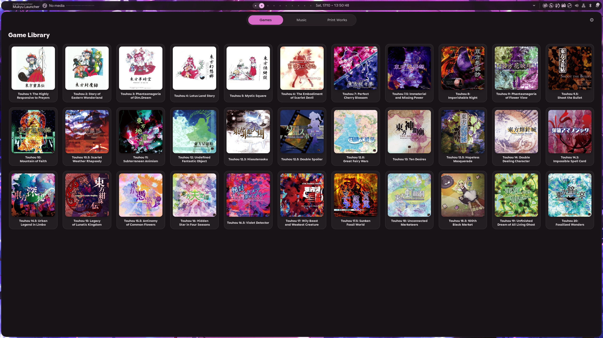
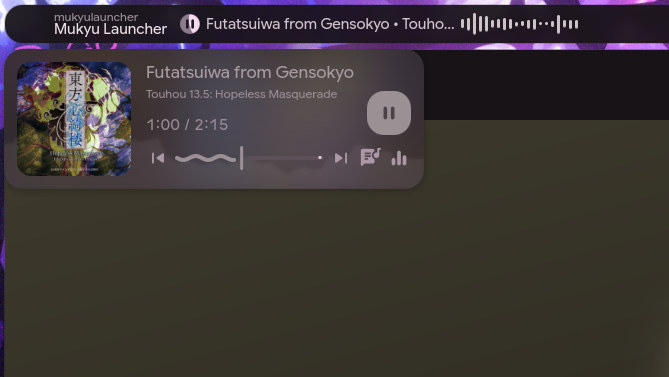
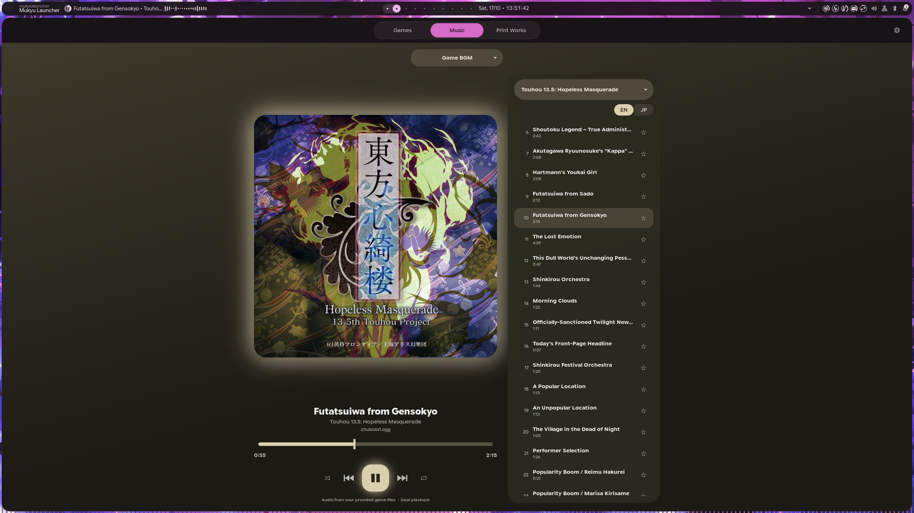
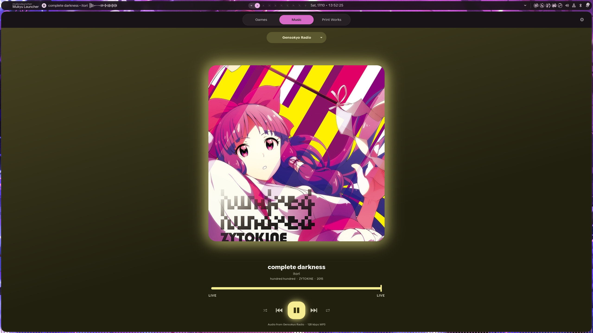
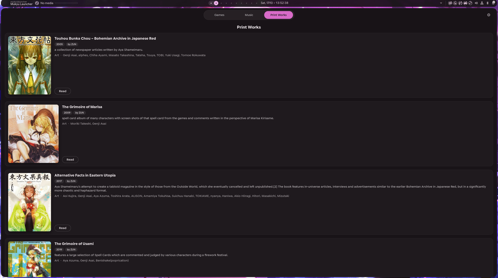
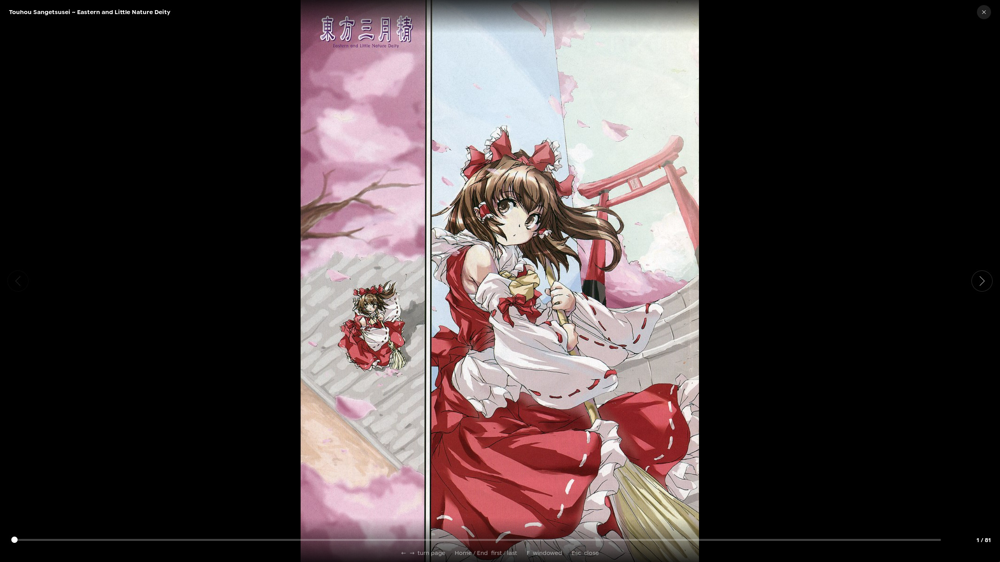

<p align="center">
  
</p>

<h1 align="center">Mukyu Launcher</h1>

<p align="center">
  <a href="../../releases/latest"></a>
  
</p>

<p align="center">
  <b>A multi-purpose Touhou launcher made for Linux. (with windows 10/11 support)</b>
</p>

Mukyu Launcher brings your Touhou collection and related media into one app: launch your games, listen to [Gensokyo Radio](https://gensokyoradio.net/) or the music from your own game files, and download and read official Touhou print works.


## Screenshots:

<table width="100%">
  <tr>
    <td width="50%" align="center" valign="top">
      <a href=".github/screenshots/game-library.jpg"></a>
      <br><b>Game library</b>
    </td>
    <td width="50%" align="center" valign="top">
      <a href=".github/screenshots/desktop-media.jpg"></a>
      <br><b>Media control widget support</b>
    </td>
  </tr>
  <tr>
    <td width="50%" align="center" valign="top">
      <a href=".github/screenshots/game-music.jpg"></a>
      <br><b>Game soundtracks</b>
    </td>
    <td width="50%" align="center" valign="top">
      <a href=".github/screenshots/gensokyo-radio.jpg"></a>
      <br><b>Gensokyo Radio</b>
    </td>
  </tr>
  <tr>
    <td width="50%" align="center" valign="top">
      <a href=".github/screenshots/printworks-library.jpg"></a>
      <br><b>Print Works library</b>
    </td>
    <td width="50%" align="center" valign="top">
      <a href=".github/screenshots/printworks-reader.jpg"></a>
      <br><b>Built-in reader</b>
    </td>
  </tr>
</table>

## Features

- **Game library** — Launch every mainline and spin-off game from one library. Wine, GE-Proton and DOSBox-X are handled for you, with per-game launch options and playtime tracking.
- **Music player** — Stream [Gensokyo Radio](https://gensokyoradio.net/) with live song info and album art, or play the soundtrack straight from your own game files, PC-98 included. Favourites, shuffle and repeat.
- **Print Works** — Download official Touhou print works and read them in the built-in PDF reader.
- **Theming** — Dark/Light with a custom accent colour.

## Notices

- Touhou Project is created by ZUN / Team Shanghai Alice. All related names and artwork belong to their respective owners.
- Mukyu Launcher is a community-made project. It is **not affiliated with, endorsed by, or sponsored by ZUN or Team Shanghai Alice**
- Mukyu Launcher does **not** distribute games or music files. You need your own copies of the games.
- Gensokyo Radio is an external service. Its availability and content are controlled by its operators.

## Installation

### Linux

#### AppImage (recommended)

Download `Mukyu_Launcher-x86_64.AppImage` from the [latest release](../../releases/latest),
make it executable and run it.

**Requirements**

- glibc 2.35 or newer (Ubuntu 22.04+, Debian 12+, Fedora 36+, Arch and other bleeding edge distros), ```getconf GNU_LIBC_VERSION``` to check glibc version
- Optional: Wine, DOSBox-X (both can also be set up from the game settings).

#### Build from source

**Build requirements**

- Rust 1.92 or newer (`rustup` or your distribution's package).
- Development headers for ALSA, fontconfig, xkbcommon and Wayland
  (Debian/Ubuntu: `libasound2-dev libfontconfig1-dev libxkbcommon-dev libwayland-dev`).

```bash
./scripts/install_thtk.sh          # thdat, used to read game BGM metadata
./scripts/install_pc98_music.sh    # PC-98 music renderers
./scripts/install_umu.sh           # umu-run, used for GE-Proton
./scripts/fetch_pdfium.sh linux lib   # PDFium for the built-in reader (x86_64)
# on ARM64, use this instead: ./scripts/fetch_pdfium.sh linux lib arm64
cargo run --release
```

To build the AppImage yourself: `bash packaging/appimage/build_appimage.sh`. On ARM64, rebuild
the bundled tools first with `./scripts/install_thtk.sh --update` and
`./scripts/install_pc98_music.sh --force`.

### Windows 10/11

Download `Mukyu_Launcher_Setup.exe` from the [latest release](../../releases/latest).

To build it yourself on Windows: build the native helpers with
`packaging/windows/build_windows_tools.ps1`, run `cargo build --release`,
`bash scripts/fetch_pdfium.sh windows build/pdfium` (on Windows on ARM:
`bash scripts/fetch_pdfium.sh windows build/pdfium arm64`),
`packaging/windows/stage.ps1 -Tools .` and compile `packaging/windows/installer.iss`
with Inno Setup (pass `/DArch=arm64` for the ARM installer).

## License and third-party notices

Mukyu Launcher's original code is licensed under the **GNU Affero General Public
License, version 3 or any later version (AGPL-3.0-or-later)**.
Third-party code, libraries and artwork retain their own copyrights and licenses.

See [third-party notices](tools/licenses/THIRD_PARTY_NOTICES.txt) for credits,
license locations and upstream projects.

## Acknowledgements

Mukyu Launcher builds on the work of open-source projects and services, such as:

- [Slint](https://slint.dev)
- [Symphonia](https://github.com/pdeljanov/Symphonia)
- [PDFium](https://pdfium.googlesource.com/pdfium/)
- [umu-launcher](https://github.com/Open-Wine-Components/umu-launcher)
- [thtk](https://github.com/thpatch/thtk)
- [98fmplayer](https://github.com/myon98/98fmplayer)
- [libx86emu](https://github.com/wfeldt/libx86emu)
- [135tk](https://github.com/brliron/135tk)
- [foo_thbgm](https://github.com/nyfair/foo_thbgm)
- [DOSBox-X](https://dosbox-x.com/)

## Issues and discussions

- Use [Issues](https://github.com/Lyrilika/mukyu-launcher/issues) to report bugs. Include your operating system, launcher version, and steps to reproduce the problem when you can. For a game-specific issue, include the Touhou title and runner you used.
- Use [Discussions](https://github.com/Lyrilika/mukyu-launcher/discussions) for questions, ideas, and feedback. A discussion is a good place to start if you are planning a larger change.

## Contributions

If you'd like to contribute, see the [contribution guide](CONTRIBUTING.md)
