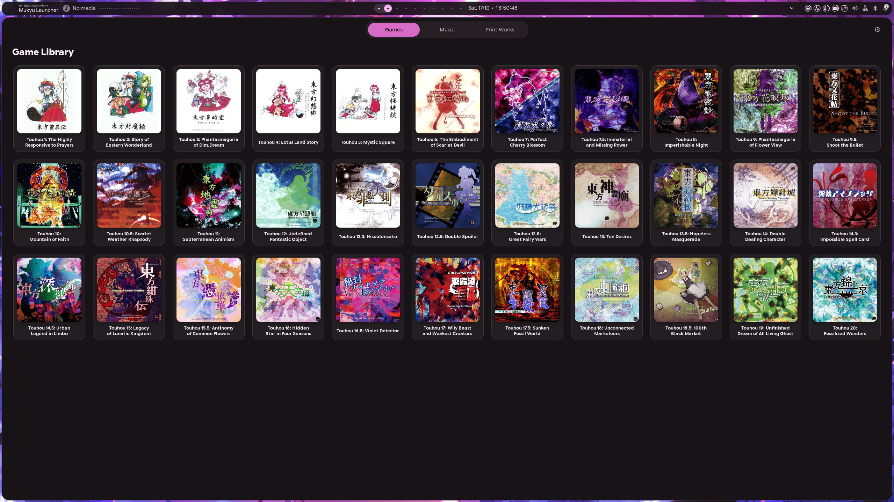
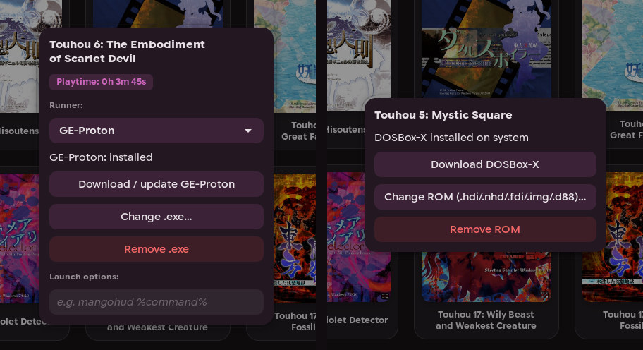
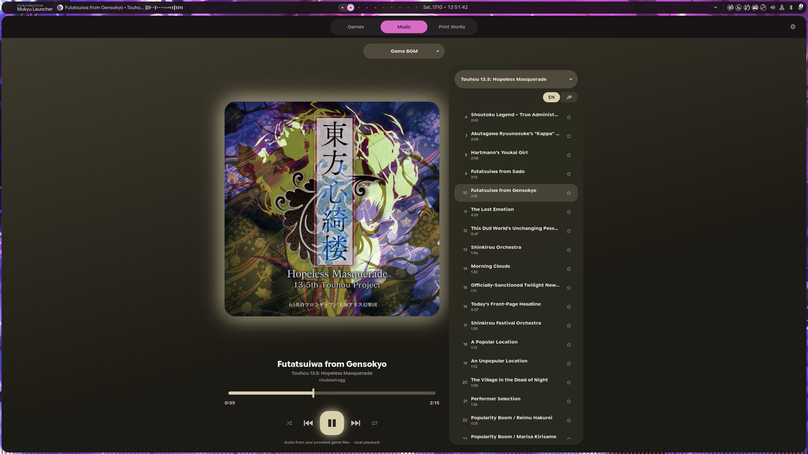
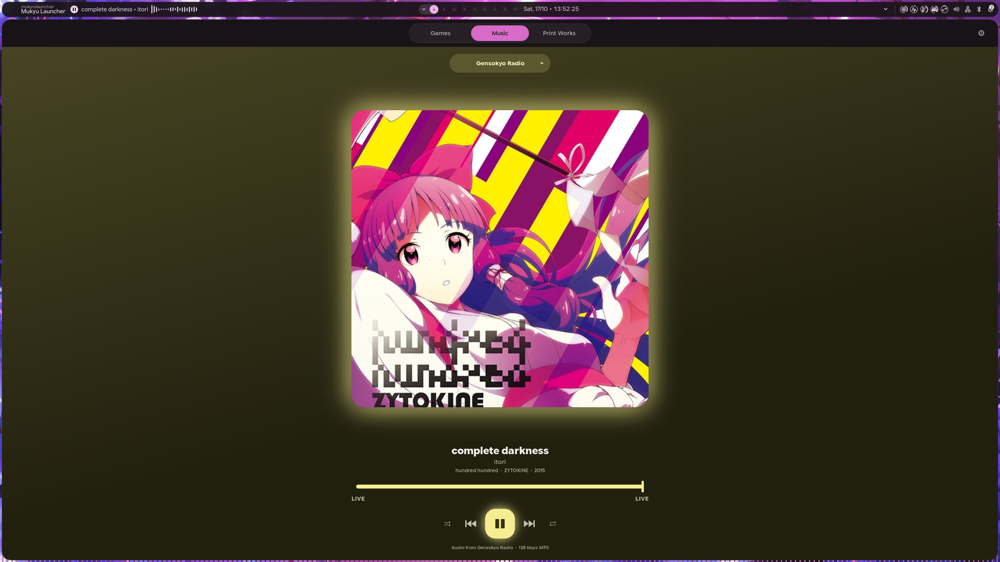
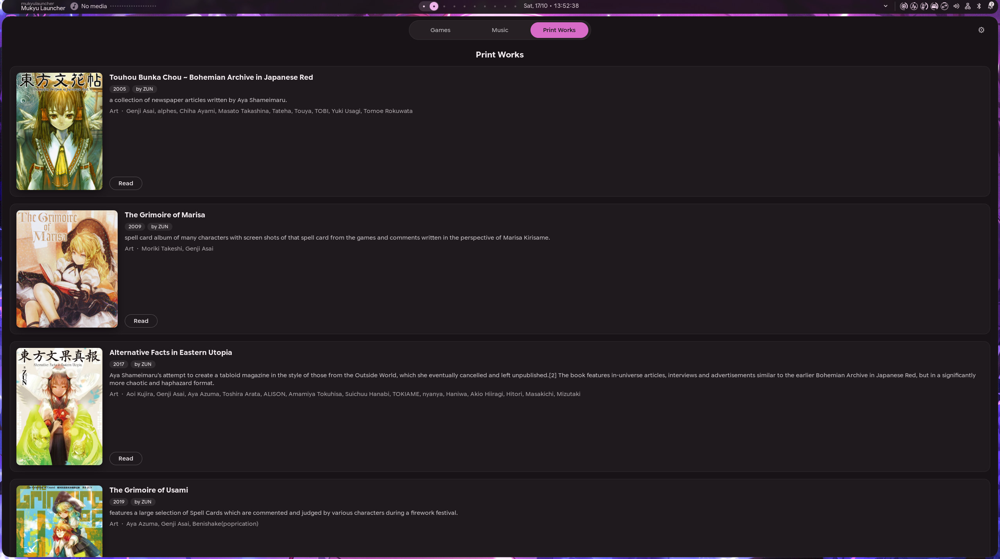
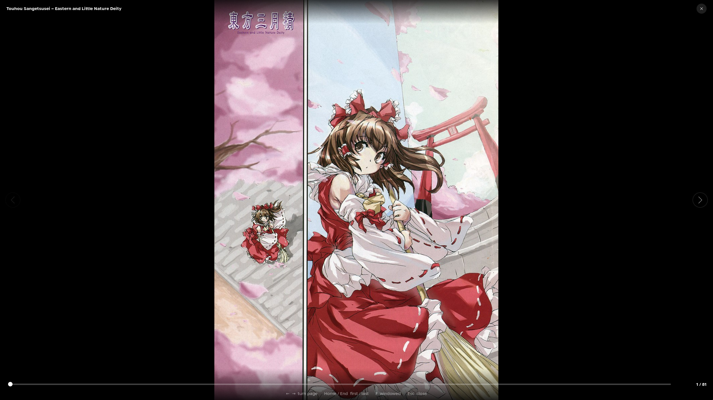
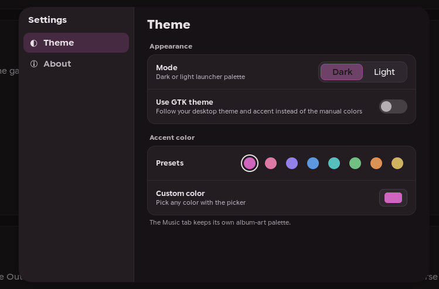
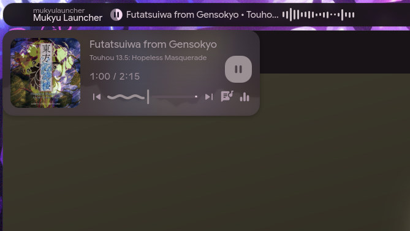

<p align="center">
  
</p>

<h1 align="center">Mukyu Launcher</h1>

<p align="center">
  <a href="../../releases/latest"></a>
  <a href="../../releases"></a>
  
</p>

<p align="center">
  <b>A multi-purpose Touhou launcher made for Linux. (with windows 10/11 support)</b>
</p>

Mukyu Launcher brings your Touhou collection and related media into one app: launch your games, listen to [Gensokyo Radio](https://gensokyoradio.net/) or the music from your own game files, and download and read official Touhou print works.


Screenshots:

<table>
  <tr>
    <td width="50%" align="center" valign="top">
      <a href=".github/screenshots/game-library.jpg"></a>
      <br><b>Game library</b>
    </td>
    <td width="50%" align="center" valign="top">
      <a href=".github/screenshots/game-settings.jpg"></a>
      <br><b>Per-game settings</b>
    </td>
  </tr>
  <tr>
    <td width="50%" align="center" valign="top">
      <a href=".github/screenshots/game-music.jpg"></a>
      <br><b>Game soundtracks</b>
    </td>
    <td width="50%" align="center" valign="top">
      <a href=".github/screenshots/gensokyo-radio.jpg"></a>
      <br><b>Gensokyo Radio</b>
    </td>
  </tr>
  <tr>
    <td width="50%" align="center" valign="top">
      <a href=".github/screenshots/printworks-library.jpg"></a>
      <br><b>Print Works library</b>
    </td>
    <td width="50%" align="center" valign="top">
      <a href=".github/screenshots/printworks-reader.jpg"></a>
      <br><b>Built-in reader</b>
    </td>
  </tr>
  <tr>
    <td width="50%" align="center" valign="top">
      <a href=".github/screenshots/theme-settings.jpg"></a>
      <br><b>Theming</b>
    </td>
    <td width="50%" align="center" valign="top">
      <a href=".github/screenshots/desktop-media.jpg"></a>
      <br><b>Media control widget support</b>
    </td>
  </tr>
</table>

## Features

- **Game library** — Launch every mainline and spin-off game from one library. Wine, GE-Proton and DOSBox-X are handled for you, with per-game launch options and playtime tracking.
- **Music player** — Stream [Gensokyo Radio](https://gensokyoradio.net/) with live song info and album art, or play the soundtrack straight from your own game files, PC-98 included. Favourites, shuffle and repeat.
- **Print Works** — Download official Touhou print works and read them in the built-in PDF reader.
- **Theming** — Dark/Light with a custom accent colour, or follow your own desktop theme.

## Notices

- Touhou Project is created by ZUN / Team Shanghai Alice. All related names and artwork belong to their respective owners.
- Mukyu Launcher is a community-made project. It is **not affiliated with, endorsed by, or sponsored by ZUN or Team Shanghai Alice**
- Mukyu Launcher does **not** distribute games or music files. You need your own copies of the games.
- Gensokyo Radio is an external service. Its availability and content are controlled by its operators.

## Installation

### Linux

#### AppImage (recommended)

Download `Mukyu_Launcher-x86_64.AppImage` from the [latest release](../../releases/latest).

**AppImage system requirements**

- glibc 2.38 or newer.
- Optional: Wine

#### Run from source

**Source requirements**

- Python 3.10 or newer.
- GTK 4.10 or newer and its GObject introspection data.
- GStreamer with its base, good and bad plugins, and gst-libav.
- PyGObject and Pycairo.
- pypdfium2.
- ffmpeg and ffprobe.
- Optional: Wine
- Optional: Dosbox-X

```bash       
./scripts/install_thtk.sh
./scripts/install_pc98_music.sh
./scripts/install_umu.sh
python3 main.py
```
### Windows 10/11 (EXPERIMENTAL)

#### Installer

Download `Mukyu_Launcher_Setup.exe` from the [latest release](../../releases/latest).

## License and third-party notices

Mukyu Launcher's original code is licensed under the **GNU Affero General Public
License, version 3 or any later version (AGPL-3.0-or-later)**.
Third-party code, libraries and artwork retain their own copyrights and licenses.

See [third-party notices](tools/licenses/THIRD_PARTY_NOTICES.txt) for credits,
license locations and upstream projects. Matching dependency sources are stored
in [third_party](third_party/) and included in GitHub’s automatic source downloads.

## Acknowledgements

Mukyu Launcher builds on the work of open-source projects and services, such as:

- [umu-launcher](https://github.com/Open-Wine-Components/umu-launcher)
- [GE-Proton](https://github.com/GloriousEggroll/proton-ge-custom)
- [thtk](https://github.com/thpatch/thtk)
- [98fmplayer](https://github.com/myon98/98fmplayer)
- [libx86emu](https://github.com/wfeldt/libx86emu)
- [135tk](https://github.com/brliron/135tk)
- [foo_thbgm](https://github.com/nyfair/foo_thbgm)
- [DOSBox-X](https://dosbox-x.com/)

## AI-assisted development

AI tools were used to assist parts of Mukyu Launcher's development, including implementation support, debugging, and troubleshooting. The project is maintained and reviewed by its human author; AI assistance does not replace testing or verification.

## Contributing

Bug reports, suggestions and pull requests are welcome.

- Have a question or an idea? [Start a discussion](../../discussions).
- Found a bug? [Open an issue](../../issues).
